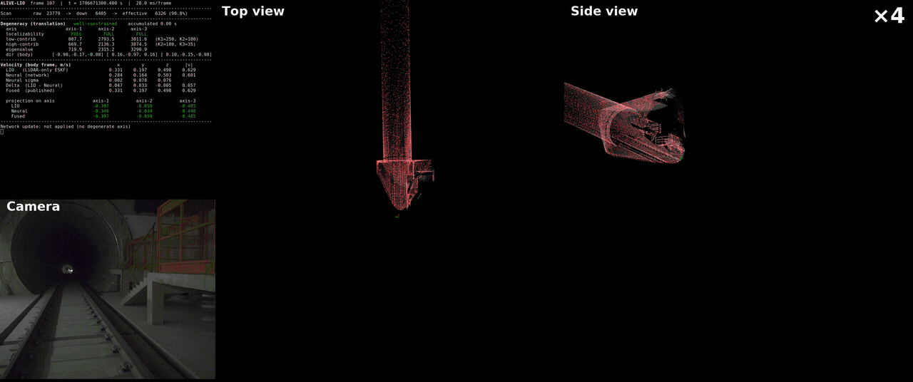
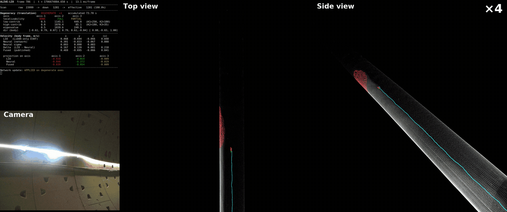

<div align="center">
    <h1>ALIVE-LIO</h1>
    <a href="https://arxiv.org/abs/2604.02706"></a>
    <h4>ALIVE-LIO: Degeneracy-Aware Learning of Inertial Velocity for Enhancing ESKF-Based LiDAR-Inertial Odometry</h4>
    <br />
    
    <p>GEODE-ShieldTunnel1</p>
    <br />
    
    <p>GEODE-ShieldTunnel5</p>
    <br />
</div>

---

## News
- **2026-10-03**: Accepted to IEEE T-ITS
- **2026-08-03**: Code released


## Pretrained Models

We release models trained for handheld and automotive platforms, one per IMU framerate. All of them ship with this repository under `onnx/model/`.

| Model | Framerate | Description |
|:---|:---:|:---|
| `model_handheld` | 200 Hz | Trained on Livox built-in IMU data |
| `model_vehicle100` | 100 Hz | Trained on the [GEODE](https://github.com/PengYu-Team/GEODE_dataset) dataset |
| `model_vehicle200` | 200 Hz | Trained on the [FusionPortableV2](https://fusionportable.github.io/dataset/fusionportable_v2/) dataset |
| `model_vehicle400` | 400 Hz | Trained on the [UrbanNav](https://github.com/IPNL-POLYU/UrbanNavDataset) dataset |

Select a model through the `localizability/model_name` parameter in your config file (without the `.onnx` extension).

To train a model on your own sequences, you can use [AirIO](https://github.com/Air-IO/Air-IO). *\*\*Note that our preprocessing step, which removes the LIO-estimated IMU bias, is not released.\*\**


## 1. Prerequisites

- **Ubuntu >= 18.04** and **ROS**. Follow [ROS Installation](http://wiki.ros.org/ROS/Installation). We used Ubuntu 20.04.
- **PCL >= 1.8**. Follow [PCL Installation](https://pointclouds.org/downloads/).
- **Eigen >= 3.3.4**. Follow [Eigen Installation](https://eigen.tuxfamily.org/index.php?title=Main_Page).
- **Sophus**. Follow [Sophus Installation](https://github.com/strasdat/Sophus).
- **ONNX Runtime**. Download from [ONNX Runtime Releases](https://github.com/microsoft/onnxruntime/releases) and extract it under `onnx/`. We used the prebuilt `onnxruntime-linux-x64-gpu-1.18.0`, and its directory name is hard-coded in `ONNX_DIR` at `CMakeLists.txt:21`. If you use another version, edit that line to match.
- **livox_ros_driver**. Follow [livox_ros_driver Installation](https://github.com/Livox-SDK/livox_ros_driver), and source it before building.


## 2. Build
Clone the repository and catkin_make:

```
    cd ~/catkin_ws/src
    git clone https://github.com/cocel-postech/alive-lio.git
    cd alive_lio
    cd ../..
    catkin_make
    source devel/setup.bash
```


## Dataset

We release two sequences recorded at [Seosan Tunnel](https://www.google.com/maps?q=36.0420409,129.3612293) (36.0420409, 129.3612293) in Pohang-si, Gyeongsangbuk-do, South Korea.

Both sequences start at one end of the tunnel, travel to the other end, and come back to the starting position. They were recorded with a Livox Avia moving sideways while mostly facing the tunnel wall. Since each sequence starts and ends at the same position, the end-to-end error can be used as a drift measure. *\*\*Note that no ground-truth trajectory is provided.\*\**

| Sequence | Duration | Description | Download |
|:---|:---:|:---|:---:|
| `handheld_light` | 357 s | Recorded under normal exposure | [link](https://drive.google.com/file/d/1rCw8kEJNhL7TqnDpgNsi-GyhMtZ4hs48/view?usp=drive_link) |
| `handheld_dark` | 380 s | Recorded with the aperture fully closed, leaving no visual cue except the tunnel lights | [link](https://drive.google.com/file/d/1UGJTsvwKg2d4kr383uVrb6LbiJkrvtJu/view?usp=drive_link) |


## TBD

- [ ] Docker support


## Citation

If you use this library for any academic work, please cite our original [paper](https://arxiv.org/abs/2604.02706).

```bibtex
@article{kim2026alive,
  title={{ALIVE-LIO}: Degeneracy-Aware Learning of Inertial Velocity for Enhancing {ESKF}-Based {LiDAR}-Inertial Odometry},
  author={Kim, Seongjun and Lee, Daehan and Hong, Junwoo and Park, Sanghyun and Jo, Hyunyoung and Han, Soohee},
  journal={arXiv preprint arXiv:2604.02706},
  year={2026}
}
```


## Acknowledgments
Thanks a lot for the authors of [PV-LIO](https://github.com/HViktorTsoi/PV-LIO), [VoxelMap](https://github.com/hku-mars/VoxelMap) and [AirIO](https://air-io.github.io/).


## License
ALIVE-LIO is released under the [GNU General Public License v2.0](LICENSE). It is built on [PV-LIO](https://github.com/HViktorTsoi/PV-LIO), [FAST-LIO2](https://github.com/hku-mars/FAST_LIO) and [VoxelMap](https://github.com/hku-mars/VoxelMap), which are GPL-2.0 licensed; the bundled [IKFoM](https://github.com/hku-mars/IKFoM) (BSD-3) and [robin-map](https://github.com/Tessil/robin-map) (MIT) keep their own licenses.

Copyright (c) 2026 Seongjun Kim, POSTECH.


## Contact

If you have any questions, please contact [Seongjun Kim](https://github.com/Seongjun-Kim00) (seongjun4527@postech.ac.kr).
